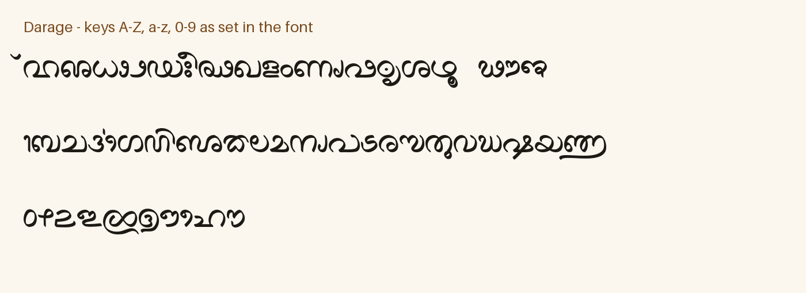

<h1 align="center">Darage</h1>
<p align="center"><em>A Tulu lipi font, with its editable source.</em></p>



Darage is the only font in the family released with its source: the Glyphs file in `sources/` is the master the OpenType font was built from, so anyone can open it, learn from it or extend it.

| | |
|---|---|
| **Designer** | Prahlad Prasad Tantry |
| **Format** | OpenType (CFF), `.otf` |
| **Glyphs** | 377 |
| **Year** | 2020 |
| **License** | [SIL OFL 1.1](OFL.txt) |
| **Family** | [Tantry Tulu Font Foundry](https://github.com/TantryTuluFonts) |

## Get the font

Download the latest build from the [Releases page](https://github.com/TantryTuluFonts/darage/releases/latest), or take `fonts/Xdareg(darage)v1(RL).otf` straight from this repository.

- **Windows:** right-click the file and choose *Install for all users*.
- **macOS:** open the file and click *Install Font*.
- **Linux:** copy it to `~/.local/share/fonts/` and run `fc-cache -f`.

## How to type with Darage

Darage is key-mapped: it places Tulu lipi glyphs on the Latin keys, so you type with an ordinary keyboard and the font draws the Tulu forms. The specimen above shows what each key produces. Because the text is stored as Latin characters, it only reads as Tulu while Darage is applied; paste it somewhere with a different font and it will show as plain Latin letters. Keep that in mind for search, sharing and archiving.

Want to modify it? Open `sources/Xdareg(darage)v1(RL).glyphs` in [Glyphs](https://glyphsapp.com). Under the OFL you can publish a modified version under your own name.

## Use on the web

```css
@font-face {
  font-family: "Darage";
  src: url("fonts/Xdareg(darage)v1(RL).otf");
  font-display: swap;
}
.tulu { font-family: "Darage", sans-serif; }
```

## License and credit

Darage is free software under the [SIL Open Font License 1.1](OFL.txt): use it in print, on screens or in products, study it, and make your own versions, as long as the font is not sold on its own and derivatives stay under the same license. Please keep the credit **Prahlad Prasad Tantry** when you share it. Full history is in the [FONTLOG](FONTLOG.md).

Questions or specimens to show off? [Open an issue](https://github.com/TantryTuluFonts/darage/issues).
